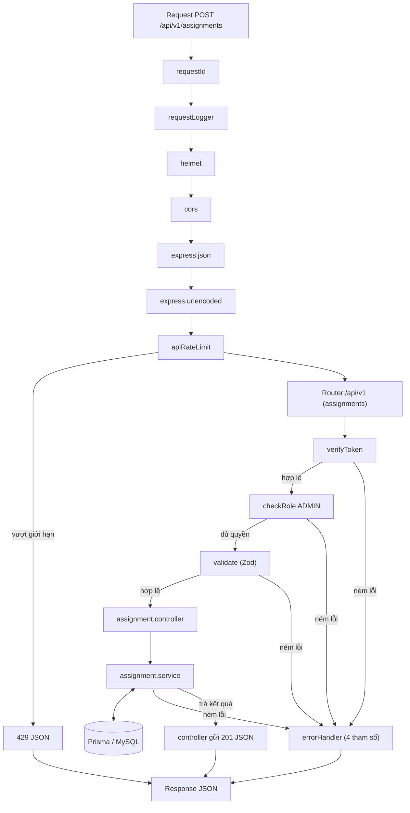

# Sơ đồ request cho chức năng phân công (`POST /api/v1/assignments`)

Sơ đồ này "phóng to" nhánh `Router /api/v1` trong `middleware-flow.md`. Phần middleware toàn cục (requestId, requestLogger, helmet, cors, json, urlencoded) giống hệt sơ đồ trong file đó.

## Thứ tự và lý do

1. `requestId`, `requestLogger`, `helmet`, `cors`, `express.json`, `express.urlencoded` chạy cho mọi request, giống `middleware-flow.md`. `express.json` phải đứng trước router, nếu không `req.body` là `undefined`.
2. `apiRateLimit` gắn cho cả `/api/v1`. Vượt giới hạn thì thư viện tự trả response 429, không đi qua `errorHandler`.
3. Router khớp `POST /api/v1/assignments` thì chuyển sang chuỗi middleware của route. Đường dẫn không khớp rơi xuống middleware 404 (xem `middleware-flow.md`).
4. `verifyToken` đứng đầu chuỗi của route: đọc token, kiểm tra chữ ký và hạn dùng, rồi gán `req.user`. `checkRole` đứng sau vì cần đọc `req.user.role` do `verifyToken` gán; đảo thứ tự thì mọi request đều bị 401.
5. Cả hai đứng **trước** `validate`: request chưa đăng nhập hoặc không đủ quyền bị chặn ngay, không tốn công kiểm tra dữ liệu hay truy vấn CSDL.
6. `validate` (Zod) đứng **trước** controller. Dữ liệu sai định dạng bị chặn ngay, không tốn truy vấn CSDL. Zod lỗi thì đi thẳng vào `errorHandler`.
7. `controller` là handler mỏng: lấy dữ liệu từ `req`, gọi service, gửi response. Controller không chứa nghiệp vụ và không gọi Prisma.
8. `service` chứa nghiệp vụ và truy cập CSDL qua Prisma. Mũi tên hai chiều vì service vừa gửi truy vấn vừa nhận kết quả.
9. Lỗi (`AppError` hoặc lỗi bất ngờ) ném ở **bất kỳ bước nào** đều nhảy thẳng đến `errorHandler`, không đi qua các bước phía sau. Lỗi ném trong hàm async cũng tự đi vào đó vì dự án dùng Express 5, nên controller không cần `try/catch`.
10. `errorHandler` đứng cuối, có đủ 4 tham số `(err, req, res, next)`, quyết định mã trạng thái và định dạng `{success, message, errors}`.

## Các bước kiểm tra trong service

Thứ tự dưới đây theo code của `assignment.service`: hệ thống dừng ở điều kiện đầu tiên không thỏa. Nếu code thay đổi thì cập nhật lại cả file này và `docs/API.md`.

| Bước | Nếu sai | Mã | Thông báo |
|---|---|---|---|
| Lớp có tồn tại? | `AppError` | 404 | `Lớp học không tồn tại` |
| `teacherId` có trong bảng `Users`? | `AppError` | 404 | `Giảng viên không tồn tại` |
| Người dùng đó có `role = TEACHER`? | `AppError` | 400 | `Người dùng này không phải giảng viên` |
| Lớp chưa có giảng viên dạy? | `AppError` | 409 | `Lớp này đã có giảng viên phụ trách` |
| Giảng viên không trùng lịch? | `AppError` | 409 | `Giảng viên trùng lịch với lớp {classCode}` |
| Giảng viên chưa dạy đủ 3 lớp? (rule của TV4) | `AppError` | 409 | `Giảng viên đã được phân công tối đa 3 lớp` |
| Tạo phân công (`status = PENDING`) | lỗi bất ngờ | 500 | `Lỗi máy chủ nội bộ` |
| Thành công | | 201 | `Phân công thành công` |

Lưu ý theo `erd.md`:

- `Assignments.classId` là `UNIQUE`, nên CSDL là lớp bảo vệ cuối cùng cho việc "một lớp một giảng viên". Bước kiểm tra "lớp đã có giảng viên?" trong service chạy trước để trả 409 rõ ràng. Nếu hai request đến cùng lúc cùng lọt qua bước này, request thứ hai bị CSDL từ chối bằng lỗi Prisma `P2002`. `errorHandler` đã ánh xạ `P2002` thành 409 (xem `error.middleware.js`), nhưng message lúc đó là câu chung "Dữ liệu bị trùng (vi phạm unique)" chứ không phải message nghiệp vụ.
- `Assignments.status` có ba giá trị `PENDING | CONFIRMED | REJECTED`. Phân công mới luôn có `status = PENDING`.

## Chưa có trong code

- **`prisma.$transaction`:** kế hoạch giao cho TV1 nhưng chưa có trong code. Hiện các bước kiểm tra và bước tạo chạy riêng lẻ, nên hai request đồng thời có thể cùng lọt qua bước kiểm tra trùng lịch và giới hạn 3 lớp. Ràng buộc `UNIQUE classId` chỉ chặn được việc một lớp có hai giảng viên, không chặn được trùng lịch hay vượt 3 lớp. Khi có transaction, thêm vào sơ đồ và bảng trên.
- **Lọc `REJECTED` (dự kiến, chờ TV1):** truy vấn trùng lịch và đếm 3 lớp hiện **không** lọc `status`. Vì chưa có endpoint đổi `status` nên mọi phân công đều là `PENDING` và chưa gây sai lệch. Khi TV1 làm, quy tắc là chỉ tính phân công `PENDING` và `CONFIRMED`.
- **`PUT`, `PATCH .../reject`, xác nhận (hướng phát triển):** không có trong kế hoạch 5 tuần và chưa có route hay service. Thiết kế đã thảo luận: giảng viên từ chối thì chuyển `REJECTED`; Admin đổi giảng viên (`PUT`, reset về `PENDING`) hoặc xóa (`DELETE`). Với thiết kế này, phân công `REJECTED` vẫn chiếm `classId` (UNIQUE), nên lớp chỉ được phân công lại sau khi Admin đổi giảng viên hoặc xóa phân công.

## Mã trạng thái HTTP trong luồng này

Mã trạng thái theo chuẩn HTTP, không phải quy ước riêng của Express. Nhóm chỉ chọn mã nào dùng cho tình huống nào. Mã được gán tại nơi ném lỗi (ví dụ `AppError` mang theo `statusCode`) và `errorHandler` gửi ra.

| Mã | Ý nghĩa | Tình huống trong chức năng phân công | Ai tạo ra |
|---|---|---|---|
| 201 | Tạo thành công | Phân công được tạo | controller |
| 400 | Request viết sai hoặc giá trị không dùng được | Thiếu `classId`, sai kiểu dữ liệu; JSON sai cú pháp; `teacherId` trỏ tới người dùng không phải giảng viên | `validate` (Zod); `errorHandler` (lỗi parse JSON); service |
| 401 | Chưa xác thực | Không có token, token sai hoặc hết hạn | `verifyToken` |
| 403 | Đã xác thực nhưng không đủ quyền | Tài khoản TEACHER gọi route tạo phân công của ADMIN | `checkRole` |
| 404 | Đối tượng không tồn tại | `classId` hoặc `teacherId` không có trong CSDL | service |
| 409 | Request đúng nhưng mâu thuẫn dữ liệu hiện có | Lớp đã có người dạy; trùng lịch; quá 3 lớp; vi phạm `UNIQUE classId` khi hai request đến cùng lúc | service; `errorHandler` (đã ánh xạ lỗi Prisma `P2002`) |
| 429 | Quá nhiều yêu cầu | Vượt giới hạn của `apiRateLimit` | `apiRateLimit` (trả trực tiếp, không qua `errorHandler`) |
| 500 | Lỗi không lường trước | Lỗi CSDL, bug; trả message chung, không lộ chi tiết, ghi vào log | `errorHandler` |

(503 chỉ dành cho `/health` khi mở rộng health check ở tuần 4, không nằm trong luồng phân công.)

Cách phân biệt nhanh:
- **400 / 404 / 409:** gửi sai định dạng thì 400 (kiểm tra được mà không cần CSDL, nên `validate` đứng trước). Gửi đúng nhưng đối tượng không có thì 404. Gửi đúng, đối tượng có, nhưng làm vậy sẽ mâu thuẫn với dữ liệu hiện có thì 409 (hai mã này cần truy vấn CSDL, nên nằm trong service). Riêng `teacherId` trỏ tới người dùng không phải giảng viên: đối tượng có, nhưng giá trị không dùng được cho thao tác này, nên dự án chọn 400 dù phải truy vấn CSDL mới biết.
- **401 / 403:** 401 là "bạn là ai?" (chưa chứng minh được danh tính), 403 là "biết bạn là ai, nhưng bạn không được làm việc này".