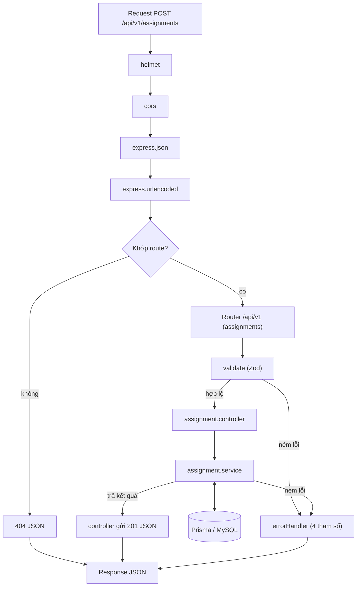

# Sơ đồ request cho chức năng phân công (`POST /api/v1/assignments`)

Sơ đồ này "phóng to" nhánh `Router /api/v1 (controller / service)` trong `middleware-flow.md`. Phần middleware toàn cục (helmet, cors, json, urlencoded) giống hệt sơ đồ tuần 1.

## Thứ tự và lý do

1. `helmet`, `cors`, `express.json`, `express.urlencoded` chạy cho mọi request, giống sơ đồ tuần 1. `express.json` phải đứng trước router, nếu không `req.body` là `undefined`.
2. Router khớp `POST /api/v1/assignments` thì chuyển sang middleware của route. Không khớp thì rơi xuống 404 JSON.
3. `validate` (Zod) đứng **trước** controller. Dữ liệu sai định dạng bị chặn ngay, không tốn truy vấn CSDL. Zod lỗi thì đi thẳng vào `errorHandler`.
4. `controller` là handler mỏng: lấy dữ liệu từ `req`, gọi service, gửi response. Controller không chứa nghiệp vụ.
5. `service` chứa nghiệp vụ và là nơi duy nhất nói chuyện với CSDL (qua Prisma). Mũi tên hai chiều vì service vừa gửi truy vấn vừa nhận kết quả.
6. Lỗi (`AppError` hoặc lỗi bất ngờ) ném ở **bất kỳ bước nào** đều nhảy thẳng đến `errorHandler`, không đi qua các bước phía sau. Lỗi ném trong hàm async cũng tự đi vào đó vì dự án dùng Express 5, nên controller không cần `try/catch`.
7. `errorHandler` đứng cuối, có đủ 4 tham số `(err, req, res, next)`, quyết định mã trạng thái và định dạng `{success, message, errors}`.

## Các bước kiểm tra trong service

Thứ tự dưới đây theo mô tả của kế hoạch. **Cần đối chiếu lại với code của TV1 và sửa nếu khác.**

| Bước | Nếu sai | Mã |
|---|---|---|
| Lớp có tồn tại? | `AppError` | 404 |
| `teacherId` có trong bảng `Users` và `role = TEACHER`? | `AppError` | 404 |
| Lớp đã có giảng viên dạy? | `AppError` | 409 |
| Giảng viên bị trùng lịch? | `AppError` | 409 |
| Giảng viên đã dạy đủ 3 lớp? (rule của TV4) | `AppError` | 409 |
| Tạo phân công (`status = PENDING`) trong `prisma.$transaction` | lỗi bất ngờ | 500 |
| Thành công | | 201 |

Lưu ý theo `erd.md`:

- `Assignments.classId` là `UNIQUE`, nên CSDL là lớp bảo vệ cuối cùng cho việc "một lớp một giảng viên". Bước kiểm tra "lớp đã có giảng viên?" trong service chạy trước để trả 409 rõ ràng. Nếu hai request đến cùng lúc cùng lọt qua bước này, request thứ hai bị CSDL từ chối bằng lỗi Prisma `P2002`. `errorHandler` đã ánh xạ `P2002` thành 409 (xem `error.middleware.js`), nhưng message lúc đó là câu chung "Dữ liệu bị trùng (vi phạm unique)" chứ không phải message nghiệp vụ.
- `Assignments.status` có ba giá trị `PENDING | CONFIRMED | REJECTED`. Đã thống nhất: phân công mới có `status = PENDING`; giảng viên từ chối thì chuyển `REJECTED`, sau đó Admin đổi giảng viên (`PUT`, reset về `PENDING`) hoặc xóa (`DELETE`). Khi giảng viên từ chối lịch, thì chuyển sang `REJECTED`, khi đó không cần kiểm tra trùng lịch và giới hạn 3 lớp nữa.

## Mã trạng thái HTTP trong luồng này

Mã trạng thái theo chuẩn HTTP, không phải quy ước riêng của Express. Nhóm chỉ chọn mã nào dùng cho tình huống nào. Mã được gán tại nơi ném lỗi (ví dụ `AppError` mang theo `statusCode`) và `errorHandler` gửi ra.

| Mã | Ý nghĩa | Tình huống trong chức năng phân công | Ai tạo ra |
|---|---|---|---|
| 201 | Tạo thành công | Phân công được tạo | controller |
| 400 | Request viết sai | Thiếu `classId`, sai kiểu dữ liệu; JSON sai cú pháp | `validate` (Zod); `errorHandler` (lỗi parse JSON) |
| 404 | Đối tượng không tồn tại | `classId` hoặc `teacherId` không có trong CSDL; đường dẫn không khớp route | service; middleware 404 |
| 409 | Request đúng nhưng mâu thuẫn dữ liệu hiện có | Lớp đã có người dạy; trùng lịch; quá 3 lớp; vi phạm `UNIQUE classId` khi hai request đến cùng lúc | service; `errorHandler` (đã ánh xạ lỗi Prisma `P2002`) |
| 500 | Lỗi không lường trước | Lỗi CSDL, bug; trả message chung, không lộ chi tiết, ghi vào log | `errorHandler` |

Hai mã dưới đây chưa có ở tuần 2 hoặc không nằm trong luồng này:

| Mã | Ý nghĩa | Khi nào | Ai tạo ra |
|---|---|---|---|
| 401 | Chưa xác thực: không có token, token sai hoặc hết hạn | Tuần 3, khi có JWT | `verifyToken` |
| 403 | Đã xác thực nhưng không đủ quyền | Tuần 3, TEACHER gọi route của ADMIN | `checkRole` |

(429 chỉ dùng cho `/auth/login`, 503 chỉ dùng cho `/health`; cả hai không nằm trong luồng phân công.)

Cách phân biệt nhanh:
- **400 / 404 / 409:** gửi sai định dạng thì 400 (kiểm tra được mà không cần CSDL, nên `validate` đứng trước). Gửi đúng nhưng đối tượng không có thì 404. Gửi đúng, đối tượng có, nhưng làm vậy sẽ mâu thuẫn với dữ liệu hiện có thì 409 (hai mã sau cần truy vấn CSDL, nên nằm trong service).
- **401 / 403:** 401 là "bạn là ai?" (chưa chứng minh được danh tính), 403 là "biết bạn là ai, nhưng bạn không được làm việc này".

## Các tuần sau sẽ bổ sung

Tuần 3 chèn `verifyToken` → `checkRole("ADMIN")` vào giữa router và `validate`; hai bước này lỗi thì đi thẳng vào `errorHandler` với mã 401 hoặc 403. Từ tuần 3, mọi request trong sơ đồ cũng có thêm bước gán request id và ghi log (pino), cập nhật vào sơ đồ khi có code.