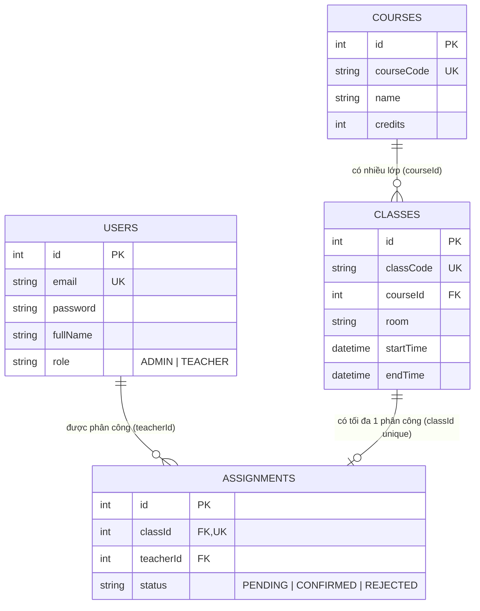

# ERD

Sơ đồ hiển thị trực tiếp trên GitHub (Mermaid). Khi viết báo cáo, chụp ảnh sơ đồ này.

## Giải thích khóa

- `Classes.courseId` là khóa ngoại tới `Courses.id`: một môn có nhiều lớp.
- `Assignments.classId` vừa là khóa ngoại tới `Classes.id` vừa `UNIQUE`: mỗi lớp chỉ có tối đa một giảng viên, và CSDL chặn sẵn việc phân công trùng lớp.
- `Assignments.teacherId` là khóa ngoại tới `Users.id` (người dùng có role `TEACHER`): một giảng viên có nhiều lớp.
- Giảng viên được lưu trong bảng `Users` với `role = TEACHER`, không có bảng riêng.
- Lịch của lớp là một khoảng thời gian cụ thể (`startTime`, `endTime`). Schema không mô hình hóa lịch lặp hằng tuần.