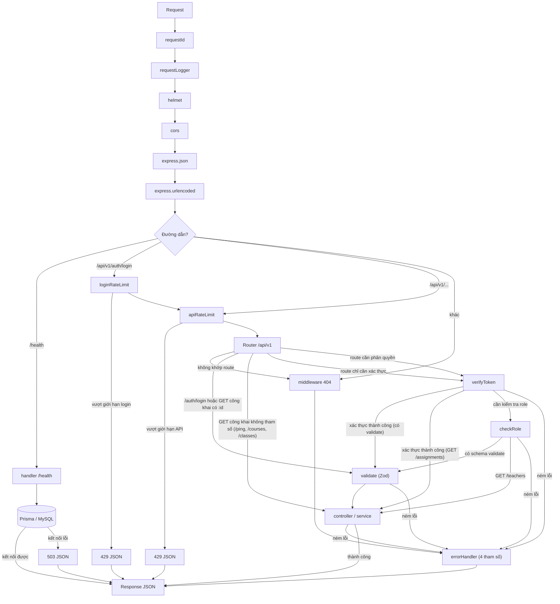

# Sơ đồ đường đi của request

## Thứ tự và lý do thiết lập Middleware

1. **`requestId`**: Đứng đầu để mọi request đều có `X-Request-Id`, kể cả request bị chặn ở bước sau. `requestLogger` đứng ngay sau để mọi dòng log (pino, dạng JSON) của một request mang cùng ID. Cả hai đứng trước `express.json`, nên lỗi "JSON không hợp lệ" (400) cũng có ID và có log.
2. **`helmet` và `cors`**: Đứng trước các bước còn lại để mọi response, kể cả lỗi, đều có header bảo mật và CORS. `cors()` hiện dùng cấu hình mặc định, chưa giới hạn origin.
3. **`express.json` và `express.urlencoded`**: Phải đứng trước router, nếu không `req.body` sẽ là `undefined`.
4. **`/health`**: Được đăng ký trước router `/api/v1`, nên không đi qua rate limit và không cần đăng nhập. Handler chạy `SELECT 1` qua Prisma: kết nối được trả 200, lỗi kết nối trả 503.
5. **`loginRateLimit`**: Được gắn riêng cho `/api/v1/auth/login`, mặc định cho phép 5 lần đăng nhập thất bại trong 15 phút và bỏ qua lần đăng nhập thành công. Sau đó request login vẫn đi qua `apiRateLimit` chung của `/api/v1`. Rate limit chung đọc từ `RATE_LIMIT_MAX` và `RATE_LIMIT_WINDOW_MS`, mặc định 100 request mỗi 15 phút. Khi vượt một trong hai giới hạn, thư viện tự trả response `429`, không đi qua `errorHandler`; response vẫn có `X-Request-Id` vì `requestId` chạy trước.
6. **Nhánh router `/api/v1`**: Được chia thành các chuỗi xử lý tùy theo yêu cầu bảo mật của từng route:
   - **Route công khai** (`/ping`, `GET /courses`, `GET /classes`): đi qua `apiRateLimit` → `validate` (nếu có `:id`) → `controller` → `service`.
   - **`/auth/login`**: `loginRateLimit` → `apiRateLimit` → `validate` → `controller` → `service`. Route này không qua `verifyToken` và `checkRole`, vì chưa có token thì không thể đăng nhập.
   - **Route chỉ cần đăng nhập** (`GET /assignments`, `GET /assignments/:id`, `POST /auth/change-password`): `verifyToken` → `validate` (nếu có schema) → `controller` → `service`.
   - **Route cần phân quyền theo vai trò**: `verifyToken` → `checkRole` → `validate` (nếu có schema) → `controller` → `service`.
7. **`verifyToken` và `checkRole`**: `verifyToken` đứng trước `checkRole` vì `checkRole` đọc `req.user.role` do `verifyToken` gán; đảo thứ tự thì mọi request đều bị `401`. Cả hai đứng trước `validate` để request chưa đăng nhập hoặc không đủ quyền bị chặn ngay, không tốn công kiểm tra dữ liệu.
8. **Middleware 404**: Đứng sau router. Nó không tự trả response mà tạo `AppError('Đường dẫn không tồn tại', 404)` rồi chuyển cho `errorHandler`, nên lỗi 404 có cùng định dạng với các lỗi khác.
9. **`errorHandler`**: Đứng cuối cùng và có đủ 4 tham số `(err, req, res, next)`, nên mới bắt được lỗi của mọi thứ đứng trước nó. Lỗi ném trong hàm async cũng tự đi vào đây vì dự án dùng Express 5.

---

## Xác thực theo nhóm route

| Nhóm route | Chuỗi kiểm tra trước controller |
| :--- | :--- |
| `/auth/login` | `loginRateLimit` → `apiRateLimit` → `validate` |
| `/auth/change-password` | `verifyToken` → `validate` |
| `courses, classes: GET /` | Không cần đăng nhập (đi thẳng vào controller) |
| `courses, classes: GET /:id` | `validate` (kiểm tra id, không cần đăng nhập) |
| `courses, classes: POST, PATCH, DELETE` | `verifyToken` → `checkRole('ADMIN')` → `validate` |
| `teachers: GET /` | `verifyToken` → `checkRole('ADMIN')` |
| `teachers: GET /:id`, `POST`, `PATCH`, `DELETE`, `PATCH /:id/password` | `verifyToken` → `checkRole('ADMIN')` → `validate` |
| `assignments: GET /` | `verifyToken` |
| `assignments: GET /:id` | `verifyToken` → `validate` |
| `assignments: POST, PUT /:id, PATCH /:id, DELETE /:id` | `verifyToken` → `checkRole('ADMIN')` → `validate` |
| `assignments: PATCH /:id/confirm`, `PATCH /:id/reject` | `verifyToken` → `checkRole('TEACHER')` → `validate` |

---

## Mã trạng thái do lớp xác thực và giới hạn tần suất tạo ra

- **`401 Unauthorized`**: Có hai nguồn:
  - `verifyToken`: thiếu token, token không hợp lệ hoặc đã hết hạn.
  - Service đăng nhập / đổi mật khẩu: sai email, sai mật khẩu hoặc sai mật khẩu cũ.
- **`403 Forbidden`**: Token hợp lệ nhưng vai trò (role) không đủ quyền thực hiện thao tác trên route đó (bị chặn tại `checkRole`), hoặc giảng viên cố xác nhận/từ chối phân công của giảng viên khác (bị chặn tại `assignment.service`).
- **`429 Too Many Requests`**: Vượt `loginRateLimit` hoặc `apiRateLimit`. Response do thư viện trả trực tiếp, không qua `errorHandler`.
