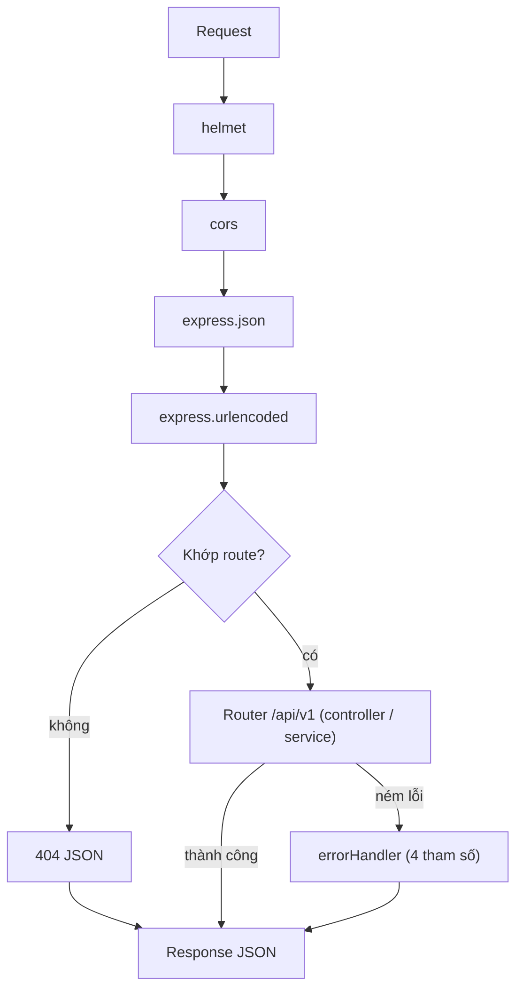

# Sơ đồ đường đi của request (tuần 1)

## Thứ tự và lý do

1. `helmet` và `cors` đứng đầu để mọi response đều có header bảo mật và CORS.
2. `express.json` phải đứng **trước** router, nếu không `req.body` là `undefined`.
3. Middleware 404 đứng sau tất cả router, bắt các đường dẫn không khớp.
4. `errorHandler` đứng **cuối cùng** và có đủ 4 tham số `(err, req, res, next)`, nên mới bắt được lỗi của mọi thứ đứng trước nó. Lỗi ném trong hàm async cũng tự đi vào đây vì dự án dùng Express 5.

## Các tuần sau sẽ bổ sung

Trong nhánh router: `rateLimit` (chỉ cho `/auth/login`) → `verifyToken` → `checkRole` → `validate` → controller → service.
