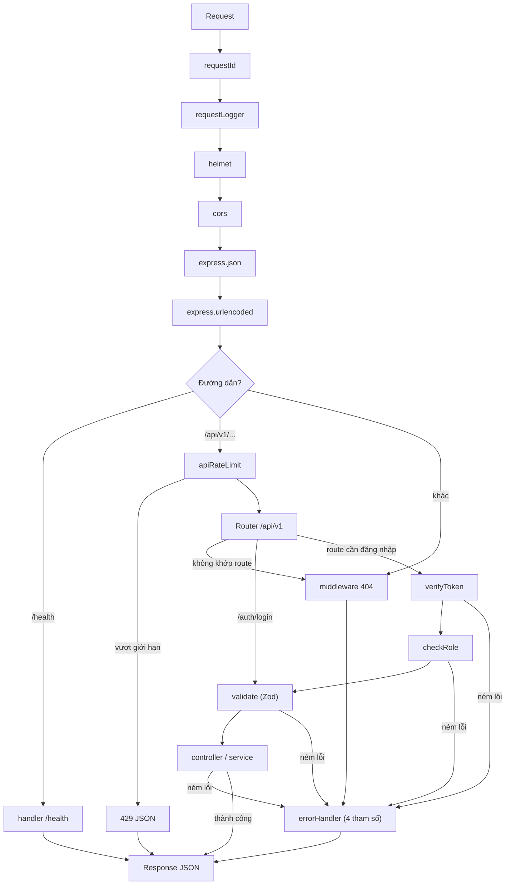

# Sơ đồ đường đi của request (cập nhật tuần 3)

## Thứ tự và lý do

1. `requestId` đứng đầu để mọi request có `X-Request-Id`, kể cả request bị chặn ở bước sau. `requestLogger` đứng ngay sau để mọi dòng log (pino, dạng JSON) của một request mang cùng id. Cả hai đứng trước `express.json`, nên lỗi "JSON không hợp lệ" (400) cũng có id và có log.
2. `helmet` và `cors` đứng trước các bước còn lại để mọi response, kể cả lỗi, đều có header bảo mật và CORS. `cors()` hiện dùng cấu hình mặc định, chưa giới hạn origin.
3. `express.json` và `express.urlencoded` phải đứng **trước** router, nếu không `req.body` là `undefined`.
4. `/health` được đăng ký **trước** router `/api/v1`, nên không đi qua `apiRateLimit` và không cần đăng nhập.
5. `apiRateLimit` gắn cho toàn bộ `/api/v1`, không riêng `/auth/login`. Giới hạn đọc từ `RATE_LIMIT_MAX` và `RATE_LIMIT_WINDOW_MS` trong `.env`; không đặt thì mặc định 100 request mỗi 15 phút. Khi vượt giới hạn, thư viện **tự trả** response 429 dạng `{success, message, errors}`, **không** đi qua `errorHandler`; response vẫn có `X-Request-Id` vì `requestId` chạy trước. Đường dẫn không tồn tại dưới `/api/v1` cũng bị tính vào giới hạn.
6. Nhánh router có hai chuỗi riêng, không gộp thành một:
   - `/auth/login`: `validate` → `controller` → `service`. Route này **không** qua `verifyToken` và `checkRole`, vì chưa có token thì không thể đăng nhập.
   - Route cần đăng nhập: `verifyToken` → `checkRole` → `validate` → `controller` → `service`. Mỗi route có schema `validate` riêng.
7. `verifyToken` đứng trước `checkRole` vì `checkRole` đọc `req.user.role` do `verifyToken` gán; đảo thứ tự thì mọi request đều bị 401. Cả hai đứng trước `validate` để request chưa đăng nhập hoặc không đủ quyền bị chặn ngay, không tốn công kiểm tra dữ liệu.
8. Middleware 404 đứng sau router. Nó **không** tự trả response mà tạo `AppError('Đường dẫn không tồn tại', 404)` rồi chuyển cho `errorHandler`, nên lỗi 404 có cùng định dạng với các lỗi khác.
9. `errorHandler` đứng **cuối cùng** và có đủ 4 tham số `(err, req, res, next)`, nên mới bắt được lỗi của mọi thứ đứng trước nó. Lỗi ném trong hàm async cũng tự đi vào đây vì dự án dùng Express 5.

## Xác thực theo nhóm route

| Nhóm route | Chuỗi kiểm tra trước controller |
|---|---|
| `/auth/login` | `validate` |
| `teachers` (mọi method) | `verifyToken` → `checkRole('ADMIN')` → `validate` |
| `classes`, `assignments`: POST, PATCH, DELETE | `verifyToken` → `checkRole('ADMIN')` → `validate` |
| `classes`, `assignments`: GET | chưa yêu cầu đăng nhập (chờ nhóm chốt) |

## Mã trạng thái do lớp xác thực và giới hạn tần suất tạo ra

- **401 Unauthorized:** có hai nguồn.
  - `verifyToken`: thiếu token, token không hợp lệ hoặc đã hết hạn.
  - Service đăng nhập: sai email hoặc sai mật khẩu (cùng một thông báo cho cả hai trường hợp).
- **403 Forbidden:** token hợp lệ nhưng vai trò (role) không đủ quyền thực hiện thao tác trên route đó, ví dụ TEACHER gọi API của ADMIN. Bị chặn tại `checkRole`.
- **429 Too Many Requests:** vượt `apiRateLimit`. Response do thư viện trả trực tiếp, không qua `errorHandler`.

## Chưa có trong code

- Giới hạn riêng cho `/auth/login` (5 lần mỗi 15 phút) theo kế hoạch: hiện chỉ có `apiRateLimit` chung cho `/api/v1`.
- Health check kiểm tra kết nối CSDL (200 khi CSDL sống, 503 khi không kết nối được): hiện `/health` chỉ trả 200.

Khi các mục trên có trong code, cập nhật sơ đồ này.